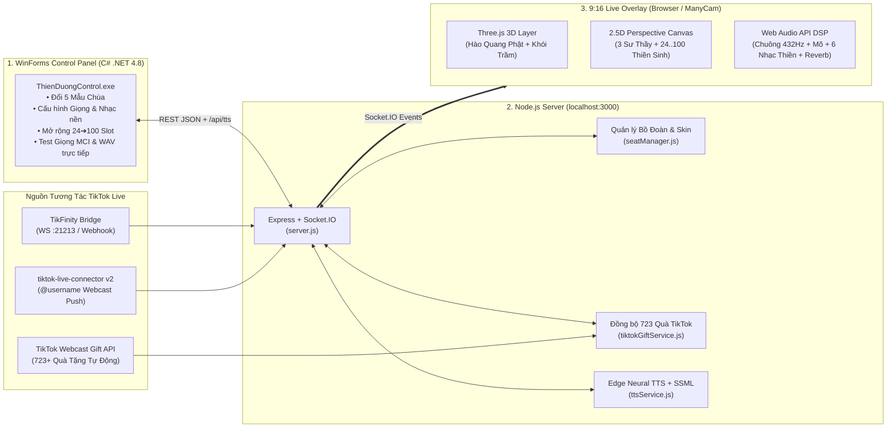

# 🙏 Thiền Đường Tịnh Tâm — Interactive TikTok Live Buddhist Meditation System

> **Tài liệu Đặc tả Kỹ thuật & Kiến trúc toàn diện (AI Porting Specification)**
> Tài liệu này được viết theo chuẩn đặc tả kỹ thuật chi tiết để bất kỳ **AI Agent** hoặc **Lập trình viên** nào cũng có thể đọc hiểu 100% cơ chế hoạt động, toán học phối cảnh, tổng hợp âm thanh DSP, giao thức REST/Socket.IO và tự động port dự án sang nền tảng khác (Unity, Godot, Unreal, Electron, WPF, Python, Mobile, v.v.).

---

## 1. Tổng Quan Kiến Trúc Hệ Thống (3-Tier Architecture)

Dự án hoạt động theo mô hình 3 thành phần giao tiếp thời gian thực qua **HTTP REST API** và **Socket.IO WebSocket** tại cổng `3000`:



---

## 2. Cấu Trúc Thư Mục Dự Án

```text
DICHUATIKTOK/
├── ThienDuongControl.exe              # File thực thi WinForms Control Panel (biên dịch sẵn)
├── start-all.bat                      # Script khởi động nhanh toàn bộ hệ thống
├── README.md                          # Tài liệu kiến trúc & đặc tả kỹ thuật để port dự án
├── control-app\                       # Mã nguồn C# WinForms (.NET Framework 4.8, C# 5 compatible)
│   ├── Program.cs                     # Entry point WinForms
│   ├── MainForm.cs                    # Giao diện điều khiển, MCI MP3 player, WAV synthesizer, API client
│   └── ThienDuongControl.csproj       # Cấu hình project C#
├── server\                            # Backend Node.js (Express + Socket.IO + Edge TTS + TikTok Live)
│   ├── package.json                   # Dependencies: express, socket.io, msedge-tts, tiktok-live-connector, ws, cors
│   ├── server.js                      # HTTP API endpoints, Socket.IO broadcaster, TikTok Live & TikFinity listeners
│   ├── seatManager.js                 # State machine quản lý 24..100 ghế, deduplication, 8 skin, 5 theme, 6 nhạc nền
│   ├── tiktokGiftService.js           # Tự động tải 723+ quà từ TikTok Webcast API & tra cứu theo giftId
│   └── ttsService.js                  # Tổng hợp giọng đọc kinh bằng msedge-tts (SSML pitch/rate) + Google TTS fallback
└── overlay\                           # Giao diện phát Live dọc 9:16 (540x960 / 1080x1920)
    ├── index.html                     # Layout HUD 9:16, nạp Three.js, Socket.IO và các module JS
    ├── favicon.svg                    # Icon Hoa Sen Vàng (tránh lỗi cache favicon trên localhost:3000)
    ├── css\
    │   └── style.css                  # Styling HUD 9:16, hiệu ứng kính mờ (glassmorphism), banner công đức
    ├── js\
    │   ├── app.js                     # Socket.IO client, đồng bộ state, quản lý đồng hồ thiền & HUD
    │   ├── templeScene.js             # Three.js (Hào quang + Khói hương) & Canvas 2.5D (24..100 thiền sinh)
    │   └── audioEngine.js             # Web Audio API: Chuông 432Hz, Mõ gỗ, 6 Nhạc nền, DSP Reverb giọng đọc
    └── assets\
        ├── themes\                    # 5 ảnh nền Chánh Điện 9:16 sạch (không dính chữ/nhân vật tĩnh)
        │   └── theme_1_bg.jpg .. theme_5_bg.jpg
        └── mockups\                   # 5 ảnh thiết kế mẫu dùng cho ô Preview trên WinForms
            └── mockup_1.jpg .. mockup_5.jpg
```

---

## 3. Đặc Tả Nghiệp Vụ Cốt Lõi (Core Domain Specification)

Khi port dự án sang ngôn ngữ hoặc Engine khác, cần giữ nguyên 4 quy tắc nghiệp vụ cốt lõi trong [`server/seatManager.js`](server/seatManager.js):

### 3.1. Năm Mẫu Không Gian Chùa (`THEMES`)
Mỗi mẫu gồm ảnh nền 9:16 riêng, bảng màu HUD, kiểu hạt bay (`particleType`) và sắc thái ánh sáng hào quang:

| ID | Tên giao diện | Câu chú hiển thị (`subtitle`) | Ảnh nền (`bgImage`) | Loại hạt (`particleType`) | Màu chủ đạo (`accentColor`) |
| :-: | :--- | :--- | :--- | :--- | :--- |
| `1` | **Chánh Điện Cổ Tự** | Nam Mô Bổn Sư Thích Ca Mâu Ni Phật | `/assets/themes/theme_1_bg.jpg` | `gold_dust` (Bụi vàng) | `#f6c453` |
| `2` | **Liên Hoa Đêm Trăng** | Án Ma Ni Bát Di Hồng · Tâm Như Thủy Nguyệt | `/assets/themes/theme_2_bg.jpg` | `firefly_lotus` (Đom đóm) | `#7ce0ff` |
| `3` | **Tây Phương Cực Lạc** | Nam Mô A Di Đà Phật | `/assets/themes/theme_3_bg.jpg` | `lotus_petals` (Cánh sen) | `#ffd966` |
| `4` | **Thiền Viện Trúc Lâm** | Tĩnh Tâm Nghe Tiếng Chuông Chùa | `/assets/themes/theme_4_bg.jpg` | `bamboo_leaves` (Lá trúc) | `#8ce99a` |
| `5` | **Chánh Điện 3D Chibi** | Cung Chúc Tân Xuân · Bình An Cát Tường | `/assets/themes/theme_5_bg.jpg` | `sparkles` (Sao lấp lánh) | `#ffbe55` |

---

### 3.2. Mười Chín Skin Nhân Vật (`CHARACTER_SKINS`) & Nhận Diện Từ Khóa Không Dấu
Người xem trên TikTok bình luận từ khóa bất kỳ trong câu chat để vào ngồi thiền hoặc đổi ngoại hình nhân vật ngay tại chỗ ngồi hiện tại:

| Mã Skin (`id`) | Tên hiển thị | Từ khóa kích hoạt (Có dấu hoặc Không dấu) | Màu Áo (`robeColor`) | Màu Y/Chi tiết (`innerColor`) | Tóc/Mũ (`headStyle`) |
| :--- | :--- | :--- | :--- | :--- | :--- |
| `nam` | Cư Sĩ Nam (Áo Tràng Xám) | `nam`, `trai`, `cu si`, `phat tu nam` | `#7b8794` | `#e2e8f0` | `male_bun` |
| `nu` | Cư Sĩ Nữ (Áo Lam Trắng) | `nu`, `nữ`, `gai`, `cu si nu` | `#edf2f7` | `#cbd5e0` | `female_lotus_bun` |
| `su` | Sư Thầy (Cà Sa Vàng) | `su`, `sư`, `thay`, `thầy`, `su thay`, `thay chua` | `#d69e2e` | `#975a16` | `monk_shaved` |
| `tieusu` | Chú Tiểu (Áo Nâu Lam) | `tieu`, `tiểu`, `chu tieu`, `chú tiểu`, `sa di` | `#b7791f` | `#ecc94b` | `novice_topknot` |
| `nicogiao` | Sư Cô / Ni Cô (Áo Lam Vàng) | `ni`, `ni co`, `su co`, `sư cô`, `ni su` | `#c09b52` | `#e2e8f0` | `monk_shaved` |
| `caotang` | Cao Tăng (Cà Sa Đỏ Tổ) | `cao tang`, `cao tăng`, `hoa thuong`, `tru tri` | `#c53030` | `#ecc94b` | `monk_halo` |
| `phattu_sen` | Phật Tử Áo Sen Hồng | `sen`, `ao sen`, `hong`, `lien hoa` | `#f687b3` | `#fff5f7` | `female_lotus_bun` |
| `phattu_vang` | Thí Chủ Hoàng Kim (VIP) | `vang`, `vàng`, `hoang kim`, `vip`, `thi chu` | `#ecc94b` | `#ffffff` | `male_crown_bun` |
| `canhsat` | 👮 Cảnh Sát / Công An | `canh sat`, `cảnh sát`, `cong an`, `công an`, `cs`, `police` | `#2f5e3d` | `#eab308` | `police_cap` |
| `bacsi` | 👨‍⚕️ Bác Sĩ Lương Y | `bac si`, `bác sĩ`, `bac sy`, `bác sỹ`, `bs`, `y ta`, `doctor` | `#f8fafc` | `#ef4444` | `doctor_cap` |
| `trom` | 🥷 Đạo Chích Hoàn Lương (Trộm) | `trom`, `trộm`, `an trom`, `dao chich`, `ke trom` | `#1e293b` | `#f1f5f9` | `thief_beanie` |
| `heo` | 🐷 Heo Hồng (Trư Bát Giới) | `heo`, `lon`, `lợn`, `con heo`, `bat gioi`, `pig` | `#f472b6` | `#fbcfe8` | `pig_ears` |
| `bo` | 🐮 Bò Sữa Ngồi Thiền | `bo`, `bò`, `con bo`, `bo sua`, `trau`, `trâu`, `cow` | `#f8fafc` | `#1e293b` | `cow_horns` |
| `ga` | 🐔 Gà Vàng Chăm Chỉ | `ga`, `gà`, `con ga`, `ga trong`, `ga con`, `chicken` | `#facc15` | `#ef4444` | `chicken_comb` |
| `hocsinh` | 🎒 Học Sinh Chăm Ngoan | `hoc sinh`, `học sinh`, `hs`, `hoc tro`, `khan quang` | `#ffffff` | `#dc2626` | `student_scarf` |
| `duccha` | ✝️ Đức Cha / Linh Mục | `duc cha`, `đức cha`, `cha`, `linh muc`, `linhmuc`, `pastor` | `#0f172a` | `#ffffff` | `priest_collar` |
| `thantai` | 💰 Thần Tài Triệu Phú | `than tai`, `thần tài`, `phat tai`, `tai loc`, `may man` | `#dc2626` | `#facc15` | `god_of_wealth` |
| `ninja` | 🥷 Ninja Nhẫn Giả | `ninja`, `nhan gia`, `nhẫn giả`, `shinobi`, `sat thu` | `#1e1b4b` | `#4338ca` | `ninja_mask` |
| `congchua` | 👑 Tiểu Công Chúa | `cong chua`, `công chúa`, `princess`, `tieu thu` | `#fbcfe8` | `#f472b6` | `princess_tiara` |

---

### 3.3. Hoạt Ảnh Đi Lên Cắm Nhang Lễ Phật (`adidaphat`)
Khi người xem bình luận các câu có chứa `adidaphat`, `a di da phat`, `nam mo a di da phat`, `cam nhang`, `thap huong`, `dang huong`, `le phat`:
1. **Pha 1: Đứng dậy & Đi lên (0.0s – 2.5s)**: Nhân vật rời bồ đoàn, di chuyển mượt mà từng bước chân tiến lên trước lư hương Chánh Điện.
2. **Pha 2: Dâng nhang & Cúi lạy 3 xá (2.5s – 6.5s)**: Xuất hiện 3 nén nhang đỏ cháy sáng bốc khói vàng trên tay, nhân vật thực hiện 3 nhịp cúi lạy cung kính trước tượng Phật, lư hương bùng sáng hào quang Three.js.
3. **Pha 3: Quay trở về bồ đoàn (6.5s – 9.0s)**: Nhân vật bước lùi về đúng vị trí bồ đoàn của mình, tiếp tục tọa thiền và kích hoạt vòng sen vàng ban phước dưới chân.

> **Lưu ý kỹ thuật khi port hàm `detectSkinFromComment(comment)`**:
> Bắt buộc chuẩn hóa chuỗi bình luận về Unicode NFD rồi xóa dấu tổ hợp `[\u0300-\u036f]` và đổi `đ -> d` (`stripVietnameseAccents`) trước khi so khớp Regex biên từ `(?:^|[\s,.;:!?\-()[\]"'])(keyword)(?=$|[\s,.;:!?\-()[\]"'])`. Lý do: bàn phím điện thoại trên TikTok thường gửi ký tự tiếng Việt tổ hợp (NFD) hoặc người xem gõ không dấu (`nu`, `su`, `cao tang`).

---

### 3.3. Quy Mô Mở Rộng Chỗ Ngồi (`SLOT_TIERS`: 24 ➔ 100 Bồ Đoàn)
Hệ thống hỗ trợ 5 bậc quy mô chiếu thiền và chế độ `auto` (tự động nâng bậc khi số người ngồi đạt $\ge 90\%$ sức chứa hiện tại):

| Chế độ (`slotMode`) | Tổng số chỗ (`total`) | Số cột (`cols`) | Số hàng (`rows`) | Ngưỡng tự động nâng bậc (`auto`): |
| :-: | :-: | :-: | :-: | :--- |
| `24` | **24 chỗ** | 4 cột | 6 hàng | Mặc định khi $\le 21$ người |
| `36` | **36 chỗ** | 6 cột | 6 hàng | Khi đạt $\ge 22$ người |
| `48` | **48 chỗ** | 6 cột | 8 hàng | Khi đạt $\ge 33$ người |
| `64` | **64 chỗ** | 8 cột | 8 hàng | Khi đạt $\ge 44$ người |
| `100` | **100 chỗ** | 10 cột | 10 hàng | Khi đạt $\ge 58$ người |

---

### 3.4. Thuật Toán Chống Trùng Lặp Chỗ Ngồi (`findAndDeduplicateUserSeat`)
Mỗi người xem TikTok **chỉ chiếm duy nhất 1 bồ đoàn** trong suốt phiên Live:
1. Khi nhận sự kiện bình luận hoặc tặng quà, trích xuất định danh chuẩn:
   - `uniqueId = data.uniqueId || data.user?.uniqueId || data.user?.displayId || data.user?.id || nickname`
   - Chuẩn hóa khóa so sánh: `normId = uniqueId.trim().toLowerCase()` và `normNick = nickname.trim().toLowerCase()`.
2. Quét toàn bộ mảng `seats`:
   - Tìm ghế đầu tiên khớp `normId` hoặc `normNick`.
   - Nếu phát hiện bất kỳ ghế trùng lặp nào khác của cùng người đó (do dữ liệu cũ), lập tức giải phóng (`occupied = false`, `user = null`) để đảm bảo 100% không bao giờ có 2 nhân vật trùng tên trên chiếu.
3. Nếu người dùng đã có ghế:
   - Giữ nguyên vị trí `seatIndex`, cập nhật `user.skin` (nếu bình luận có từ khóa đổi skin), cập nhật `prayerText` và `lastActive`.
4. Nếu người dùng chưa có ghế:
   - Tìm ghế trống (`!occupied`) đầu tiên. Nếu đầy và đang ở chế độ `auto`, tự động mở rộng lên bậc tiếp theo (`24 -> 36 -> 48 -> 64 -> 100`). Nếu đã kịch trần, thay thế ghế có `lastActive` lâu nhất và chưa có điểm công đức (`meritPoints === 0`).

---

## 4. Đặc Tả Âm Thanh, Nhạc Nền & Giọng Đọc Kinh (Audio & TTS Spec)

### 4.1. Bốn Cấu Hình Giọng Đọc Kinh (`VOICE_PRESETS`)
Được xử lý tại [`server/ttsService.js`](server/ttsService.js) thông qua thư viện `msedge-tts` với định dạng `AUDIO_24KHZ_48KBITRATE_MONO_MP3` và thẻ SSML `<prosody>`:

| Mã Giọng (`id`) | Tên hiển thị | Voice Engine (`voiceName`) | Độ trầm (`pitchHz`) | Tốc độ (`ratePercent`) | Độ vang (`reverbLevel`) | Tốc độ MCI WinForms |
| :--- | :--- | :--- | :-: | :-: | :-: | :-: |
| `nam_tram_doc_kinh` | Giọng Nam Trầm Ấm Đọc Kinh | `vi-VN-NamMinhNeural` | `-18Hz` | `-20%` | `0.28` | `930` |
| `lao_hoa_thuong` | Giọng Lão Hòa Thượng Uy Nghiêm | `vi-VN-NamMinhNeural` | `-36Hz` | `-28%` | `0.38` | `860` |
| `thay_phap_thoai` | Giọng Thầy Trẻ Ấm Áp Pháp Thoại | `vi-VN-NamMinhNeural` | `-4Hz` | `-8%` | `0.18` | `990` |
| `su_co_thanh_tinh` | Giọng Sư Cô Thanh Tịnh Dịu Hiền | `vi-VN-HoaiMyNeural` | `-12Hz` | `-18%` | `0.26` | `940` |

- **Quy tắc chuẩn hóa câu đọc kinh (`normalizeChantText`)**: Tự động thêm dấu nghỉ nhịp trang nghiêm sau các danh hiệu Phật (`Nam Mô Bổn Sư Thích Ca Mâu Ni Phật.`, `Nam Mô A Di Đà Phật.`) để giọng TTS ngắt hơi giống sư thầy tụng kinh.
- **Quản lý tài nguyên WebSocket TTS**: Luôn gọi `tts.close()` trong khối `finally` sau mỗi lần gọi `toStream()` của `msedge-tts` để tránh rò rỉ socket.

### 4.2. Chuỗi Xử Lý Âm Thanh Chánh Điện Trên Trình Duyệt (`overlay/js/audioEngine.js`)
Khi Overlay nhận gói `chant_speech` (chứa `audioBase64`), âm thanh đi qua chuỗi Web Audio API DSP:
1. **`playbackRate`**: Hạ nhẹ xuống `0.94` (nếu dùng fallback TTS) hoặc giữ `1.0` (nếu đã hạ pitch bằng SSML) để tạo chất giọng dày.
2. **Low-Shelf Warmth Filter**: `BiquadFilterNode` kiểu `lowshelf` tại tần số `165 Hz`, độ lợi `+7 dB` (tăng âm ngực trầm ấm).
3. **High-Cut Softener**: `BiquadFilterNode` kiểu `highshelf` tại tần số `3800 Hz`, độ lợi `-5 dB` (khử tiếng xì gắt).
4. **ConvolverNode (Temple Hall Reverb)**: Impulse Response tự sinh dài `2.8 giây` với hàm suy giảm mũ $(1 - t/L)^{2.4}$ tạo độ ngân vang tự nhiên trong chánh điện.

### 4.3. Sáu Bản Nhạc Nền Thiền Đường (`BG_MUSIC_CATALOG`)
Được tổng hợp thời gian thực bằng Web Audio API trong [`overlay/js/audioEngine.js`](overlay/js/audioEngine.js) (không lo bản quyền khi phát Live TikTok) cộng với chế độ phát file `.mp3` tùy chọn:
1. `zen_pentatonic_432`: Nhạc Thiền Tĩnh Tâm 432Hz (Drone `108Hz`/`216Hz` + Chuông xoay Ngũ Cung).
2. `omitofo_chant_pad`: Giai Điệu Niệm Phật A Di Đà (Hợp âm ấm + Đàn Tranh gảy giai điệu `A4 - G4 - E4 - D4`).
3. `guzheng_lotus_pond`: Cổ Tranh Liên Hoa Đêm Trăng (Đàn Tranh Karplus-Strong / Plucked String + Tiêu Trúc).
4. `singing_bowl_meditation`: Chuông Xoay Tây Tạng (`216Hz`, `324Hz`, `432Hz`, `540Hz` ngân dài).
5. `temple_night_ambience`: Tĩnh Lặng Chùa Đêm & Chuông Gió Hiên Chùa (`1080Hz - 1920Hz`).
6. `custom_mp3`: Phát trực tiếp file `.MP3` bất kỳ từ máy tính thông qua endpoint `POST /api/music/custom` và `GET /api/music/stream`.

---

## 5. Đặc Tả Đồ Họa 9:16 Overlay (`overlay/js/templeScene.js`)

Khung hình chuẩn `9:16` (`540x960` hoặc `1080x1920`) gồm 3 lớp chồng lên nhau:
1. **Lớp 1 (Background Plate)**: Ảnh nền Chánh Điện thuộc 1 trong 5 mẫu (`theme_1_bg.jpg` .. `theme_5_bg.jpg`).
2. **Lớp 2 (Three.js WebGL Canvas)**:
   - Vòng hào quang Phật phía sau tượng Phật (xoay chậm, phát sáng dịu).
   - Làn khói hương trầm 3D bay lên từ lư hương giữa điện.
   - Hệ thống hạt 3D theo từng chủ đề (`gold_dust`, `firefly_lotus`, `lotus_petals`, `bamboo_leaves`, `sparkles`).
3. **Lớp 3 (2.5D Perspective Canvas)**:
   - **Hàng Sư Thầy cố định phía trên chiếu** (`y = 0.562 * H`): `Thầy Minh Đạo` (trái), `Sư Trụ Trì` (giữa - gõ mõ theo nhịp BPM), `Thầy Tâm Từ` (phải).
   - **Phép chiếu phối cảnh hình thang cho lưới $R \times C$ bồ đoàn** (`projectGridPoint(row, col, rows, cols)`):
     - Tọa độ chuẩn hóa theo chiều sâu: $t = \frac{\text{row}}{\max(1, \text{rows} - 1)} \in [0, 1]$
     - Tung độ màn hình (hiệu ứng xa gần phi tuyến):
       $$y = H \cdot \left(0.618 + 0.305 \cdot t^{1.06}\right)$$
     - Độ rộng hàng chiếu nở dần từ trên xuống dưới:
       $$W_{\text{row}} = W \cdot \text{lerp}(0.62, 0.90, t)$$
     - Hệ số thu phóng kích thước nhân vật theo cả chiều sâu $t$ và tổng số ghế $N_{\text{total}}$:
       $$\text{scale} = \text{lerp}(0.72, 1.06, t) \cdot \text{clamp}\left(\sqrt{\frac{24}{N_{\text{total}}}}, 0.50, 1.0\right)$$

---

## 6. Đặc Tả Kết Nối TikTok Live & Danh Mục Quà Tự Động

### 6.1. Giải pháp Kết nối TikTok Live Miễn phí 100% (`server/server.js`)
Trong thư viện `tiktok-live-connector` (v2.x):
- Nếu bật `enableExtendedGiftInfo: true`, thư viện sẽ gọi qua máy chủ trung gian EulerStream và báo lỗi `Failed to sign a request: This endpoint requires a Business plan`.
- **Giải pháp chuẩn đã áp dụng**:
  1. Khởi tạo kết nối với `enableExtendedGiftInfo: false` và `processInitialData: true`:
     ```js
     const conn = new ConnClass(username, {
       processInitialData: true,
       enableExtendedGiftInfo: false
     });
     ```
  2. Lấy danh sách toàn bộ quà tặng trực tiếp từ **TikTok Webcast Public API** trong [`server/tiktokGiftService.js`](server/tiktokGiftService.js):
     ```text
     GET https://webcast.tiktok.com/webcast/gift/list/?aid=1988&app_language=vi-VN&language=vi&room_id={roomId}
     ```
     API này hoàn toàn miễn phí, trả về đầy đủ **~723 quà tặng TikTok** kèm `id`, `name`, `diamond_count` và `image.url_list[0]`.
  3. Khi sự kiện `conn.on('gift', data)` nổ ra trên Live, dùng `giftService.resolveGift(data)` tra cứu `data.giftId` trong Map 723 quà để lấy chính xác tên quà tiếng Việt và số xu (`diamondCount`).

---

## 7. Hợp Đồng Giao Tiếp API & Socket.IO (API Contract)

### 7.1. HTTP REST Endpoints (`http://localhost:3000`)

| Phương thức & Đường dẫn | Payload JSON (Body / Query) | Chức năng |
| :--- | :--- | :--- |
| `GET /api/state` | — | Trả về toàn bộ trạng thái phòng thiền (`seats`, `themes`, `voiceConfig`, `leaderboard`, `slotMode`) |
| `POST /api/theme` | `{ "themeId": 1..5 }` | Đổi trực tiếp mẫu giao diện chùa trên Live |
| `POST /api/seats/mode` | `{ "slotMode": "auto" \| "24" \| "36" \| "48" \| "64" \| "100" }` | Đổi quy mô số lượng bồ đoàn |
| `POST /api/seats/sample` | `{ "count": 15 \| 36 \| 64 \| 100 }` | Điền nhanh $N$ thiền sinh mẫu để kiểm thử bố cục |
| `POST /api/seats/clear` | `{ "seatIndex"?: number }` | Giải phóng 1 ghế hoặc xóa trắng toàn bộ bồ đoàn |
| `POST /api/comment` | `{ "uniqueId", "nickname", "comment" }` | Cho người xem vào ngồi thiền hoặc đổi skin tại chỗ |
| `POST /api/gift` | `{ "uniqueId", "nickname", "giftName", "diamondCount", "presetId"?, "voiceName"?, "pitchHz"?, "ratePercent"? }` | Tặng quà, cộng Công Đức và phát giọng đọc kinh xướng tên hồi hướng |
| `GET /api/tiktok/gifts` | — | Trả về danh sách 723+ quà tặng từ TikTok Webcast API |
| `POST /api/tiktok/gifts/refresh` | `{ "roomId"?: string }` | Làm mới danh mục quà tặng từ TikTok API |
| `POST /api/tiktok/connect` | `{ "username": "@ten_kenh" }` | Kết nối trực tiếp vào phòng Live TikTok đang phát |
| `POST /api/tiktok/autodemo` | `{ "enable": true \| false }` | Bật/tắt luồng giả lập người xem bình luận & tặng quà tự động |
| `POST /api/voice/config` | `{ "presetId", "voiceName", "pitchHz", "ratePercent", "reverbLevel", "woodenFishBpm", "bgMusicTrack", ... }` | Cập nhật cấu hình giọng đọc, tiếng mõ và nhạc nền |
| `POST /api/hud/config` | `{ "guidePosition", "guideOffsetY", "guideOpacity", "guideCollapsed" }` | Cập nhật vị trí khung hướng dẫn (tránh che Thầy & bình luận) |
| `POST /api/overlay/reload` | — | Lệnh làm mới toàn bộ màn hình Overlay trên OBS Studio / Trình duyệt |
| `GET /api/tts` | `?text=...&presetId=...&voiceName=...&pitchHz=...&ratePercent=...` | Trả về luồng `audio/mpeg` MP3 để WinForms phát thử trực tiếp |
| `POST /api/music/custom` | `{ "filePath": "C:\\...\\nhac.mp3" }` | Nạp file nhạc nền `.mp3` từ máy tính để phát trên Overlay |

### 7.2. Sự Kiện Socket.IO (`Server ➔ Overlay Client`)

| Tên sự kiện | Dữ liệu (`payload`) | Hành động phía Overlay |
| :--- | :--- | :--- |
| `state_update` | `seatManager.getState()` | Cập nhật toàn bộ lưới bồ đoàn, bảng Công Đức, cấu hình âm thanh |
| `hud_config_changed` | `hudConfig` | Cập nhật vị trí, độ cao offset Y, độ mờ opacity và gập/mở khung HUD |
| `reload_overlay` | `{}` | Tự động làm mới trang Overlay trên mọi màn hình OBS đang phát |
| `theme_changed` | `{ themeId, theme }` | Chuyển cảnh nền 9:16, đổi màu HUD và hệ hạt 3D |
| `seat_event` | `{ action: 'join' \| 'update' \| 'offer_incense', seatIndex, seat }` | Tạo hiệu ứng hào quang tại ghế hoặc kích hoạt bước đi dâng hương |
| `gift_event` | `{ donorName, giftName, points, seatIndex, chantText }` | Hiển thị Banner Công Đức + hiệu ứng hoa sen vàng + thỉnh chuông |
| `chant_speech` | `{ text, audioBase64, voiceConfig, donorName? }` | Phát giọng đọc kinh qua bộ lọc DSP Low-Shelf + Temple Reverb |
| `voice_config_changed` | `voiceConfig` | Cập nhật tức thì nhạc nền, nhịp mõ BPM và cấu hình giọng |
| `bell_ring` | `{ reason }` | Thỉnh 1 tiếng Đại Hồng Chung 432Hz + hiệu ứng sóng âm |
| `wooden_fish_hit` | `{}` | Gõ 1 nhịp Mõ gỗ + hoạt ảnh Sư Trụ Trì gõ mõ |

---

## 8. Web Admin Dashboard & Cơ Chế Hot Reload Không Tắt App

### 8.1. Bảng Điều Khiển Web Admin (`http://localhost:3000/admin`)
Bên cạnh WinForms Control Panel (`ThienDuongControl.exe`), hệ thống cung cấp giao diện Web Admin chuẩn responsive trên trình duyệt:
- **Cột 1 (Giao diện Chùa)**: Xem trước hình ảnh 5 mẫu chùa, bấm chuyển đổi tức thời trên OBS Live Stream.
- **Cột 2 (Giọng Đọc & Âm Thanh)**: Chọn 4 mẫu giọng, thanh trượt Pitch, Rate, Reverb, 6 bản nhạc thiền 432Hz, nạp file MP3 từ máy tính và nút "Nghe thử TTS".
- **Cột 3 (Quy Mô & Khung UI)**: Tùy biến vị trí khung hướng dẫn (tránh che hình Thầy Minh Đạo), thanh trượt độ lệch dọc Y, độ mờ Opacity, chế độ gập mở và điền mẫu 15..100 chỗ.
- **Cột 4 (Giả Lập & Quà TikTok)**: Kết nối trực tiếp `@username` TikTok, giả lập 19 skin nhân vật, bình luận `adidaphat` lên cắm nhang, chọn từ danh mục **723 quà tặng TikTok API** và nhật ký hoạt động trực tiếp.

### 8.2. Cơ Chế Lưu Trạng Thái & Làm Mới Tự Động (Hot Reload)
- File trạng thái [`server/runtime_state.json`](server/runtime_state.json) tự động lưu lại toàn bộ danh sách Phật tử đang ngồi thiền, vị trí bồ đoàn, điểm công đức và cấu hình giọng/theme.
- Khi cập nhật mã nguồn hoặc khởi động lại server, trạng thái được khôi phục nguyên vẹn trong $\approx 0.1$ giây.
- Bấm nút **🔄 Làm Mới Overlay** trên Web Admin hoặc gọi `POST /api/overlay/reload` sẽ gửi tín hiệu qua Socket.IO để tất cả các nguồn trình duyệt OBS Studio tự động tải lại mà không cần tắt ứng dụng hay ngắt phiên live!

---

## 8. Hướng Dẫn Biên Dịch & Chạy Hệ Thống

### 8.1. Yêu cầu Môi trường
- **Hệ điều hành**: Windows 10 / 11 (có sẵn `.NET Framework 4.8` tại `C:\Windows\Microsoft.NET\Framework64\v4.0.30319\csc.exe`).
- **Node.js**: Phiên bản `>= 18.x`.

### 8.2. Cài đặt & Khởi chạy Server Node.js
```powershell
cd g:\WEB\Tiktok\server
npm install
node server.js
```

### 8.3. Biên dịch lại WinForms Control Panel (`ThienDuongControl.exe`)
Dự án WinForms được viết tương thích chuẩn C# 5 để biên dịch trực tiếp bằng trình biên dịch `csc.exe` tích hợp sẵn trong Windows mà không cần cài đặt bộ Visual Studio nặng:
```powershell
"C:\Windows\Microsoft.NET\Framework64\v4.0.30319\csc.exe" /nologo /target:winexe /out:"g:\WEB\Tiktok\ThienDuongControl.exe" /r:System.dll,System.Drawing.dll,System.Windows.Forms.dll "g:\WEB\Tiktok\control-app\Program.cs" "g:\WEB\Tiktok\control-app\MainForm.cs"
```

### 8.4. Phát lên TikTok LIVE Studio / OBS / ManyCam
1. Mở [`ThienDuongControl.exe`](ThienDuongControl.exe) (tự động bật Node Server và nạp 723 quà từ TikTok API).
2. Bấm **📱 Mở Cửa Sổ Overlay 9:16** (hoặc thêm nguồn **Browser / Liên kết** `http://localhost:3000` với kích thước `1080x1920` trong **TikTok LIVE Studio** / **OBS**).
3. Nhập `@username` kênh TikTok đang bật Live vào ô **🔴 Nhập @ID Kênh TikTok đang Live** rồi bấm **🔗 Kết Nối**.

---

## 9. Phiên Bản Độc Quyền: Pixel Art / Retro 16-Bit Overlay (`http://localhost:3000/pixel`)

Hệ thống tích hợp sẵn một phiên bản **Pixel Art 16-Bit Retro hoài niệm** hoàn toàn không đụng hàng trên TikTok Live:
- **Ý tưởng thiết kế**: Lấy cảm hứng từ các tựa game Zen Master / RPG 16-bit cổ điển (Chrono Trigger, Golden Sun, EarthBound).
- **Kiến trúc Chánh Điện 16-bit**: Mái ngói âm dương cong vút, câu đối chữ vàng, tượng Phật Thích Ca dát vàng tỏa hào quang tuần hoàn (palette cycling), bàn thờ Tam Bảo và lư hương nghi ngút khói pixelated.
- **Hoạt ảnh Sư Trụ Trì gõ mõ**: Tự động vung dùi gõ mõ theo sự kiện `wooden_fish_hit` hoặc nhịp BPM, nốt nhạc bay lên theo nhịp tụng kinh.
- **19 Skin Thiền Sinh Pixel**: Vẽ bằng thuật toán tạo sprite 16-bit chuyên biệt, cử động thở thiền (Breathing idle) nhẹ nhàng 1-2 pixel.
- **Hoạt ảnh Cắm Nhang (`adidaphat`)**: Nhân vật bước đi 16-bit walk-cycle lên trước lư hương, cúi lạy 3 xá dâng 3 nén nhang đỏ có lửa bốc khói rồi lùi về vị trí.
- **Hiệu ứng CRT Scanlines & Sớ Vàng RPG**: Hộp thoại xướng tên công đức thiết kế chuẩn khung hội thoại game nhập vai 16-bit kinh điển.
- **Tương thích 100%**: Sử dụng chung toàn bộ Socket.IO backend, đồng bộ hoàn hảo với WinForms Control Panel và Web Admin.
